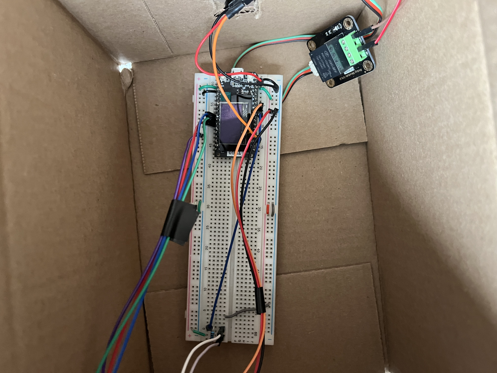
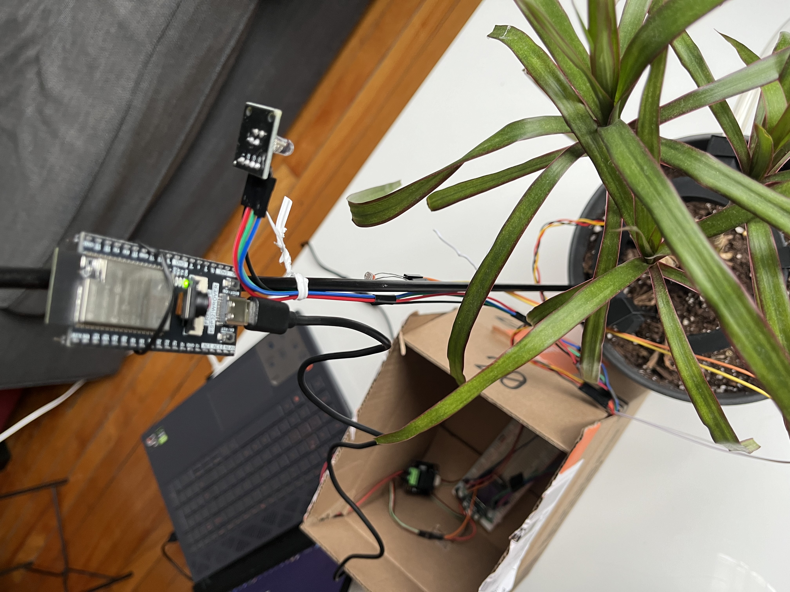
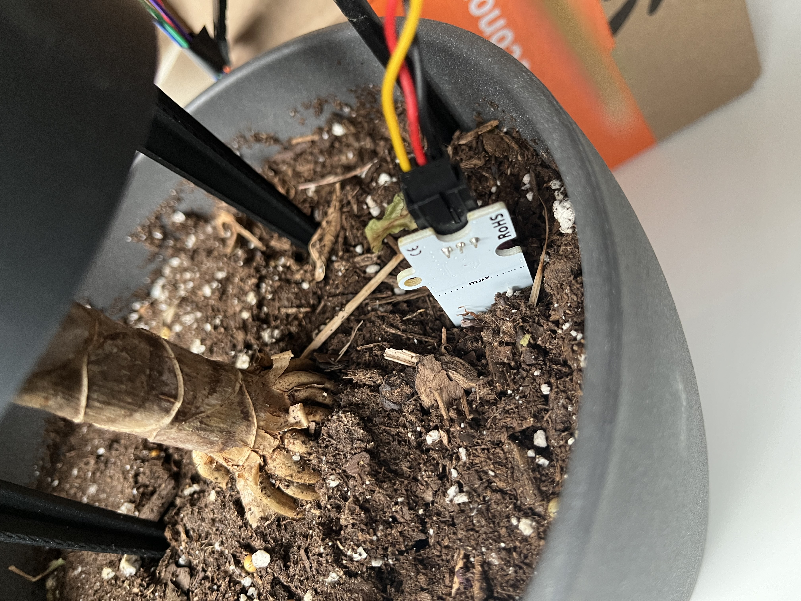
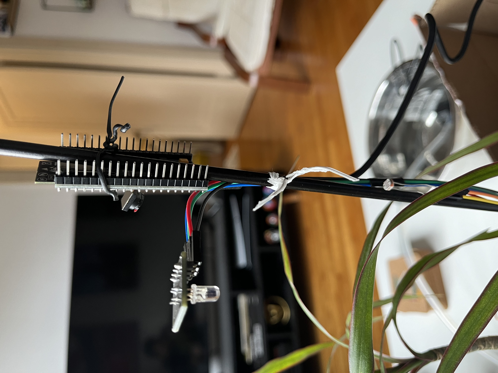
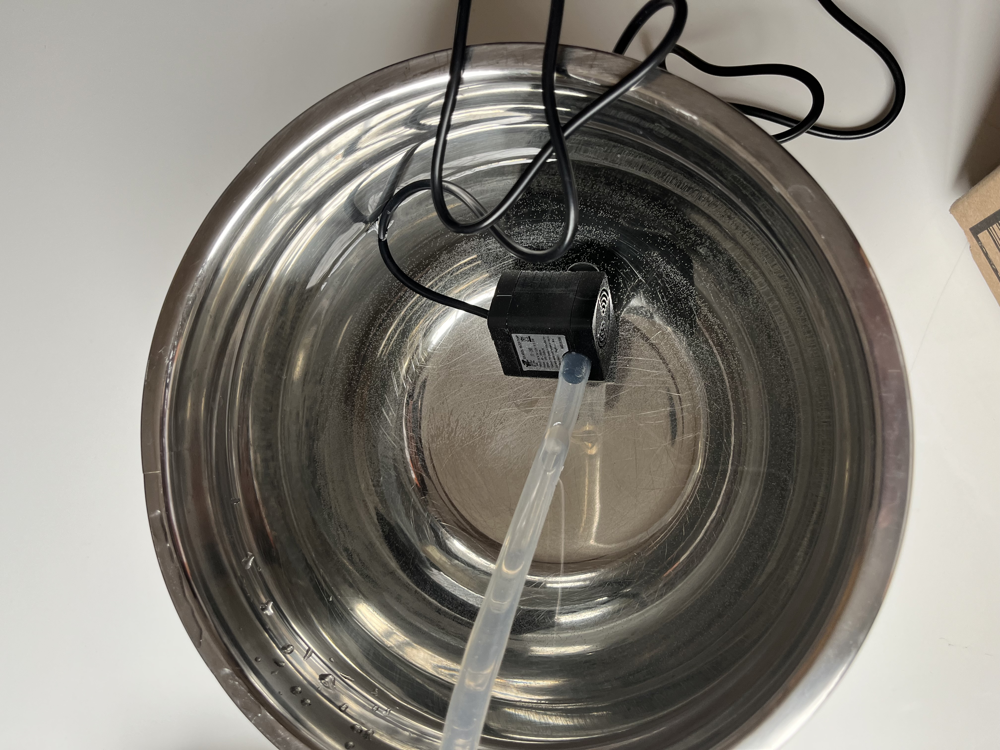
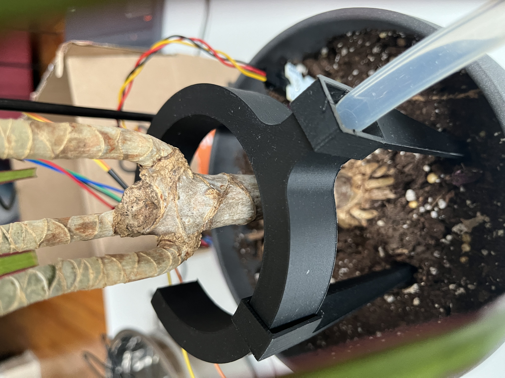

# Plant Care System

**A ~$30 plant monitoring and care system built on ESP32 microcontrollers and Firebase.**

Two ESP32 nodes report to Firebase. **The Gardener** reads soil moisture and light, waters the plant automatically when the soil gets dry, and drives an LED. **The Photographer** photographs the plant. A live web dashboard shows each plant's readings and latest photo, with buttons to water or light it remotely.

Built for **SOEN 422 (Embedded Systems and Software)** at Concordia University.

<p align="center">
  <video src="docs/media/demo_pt2.MOV" controls width="800"></video>
</p>

## Features

- **Moisture and light monitoring:** moisture in %, light on a five-level scale; below 30% moisture the plant is flagged *Needs Water*.
- **Automatic watering:** the Gardener turns on the pump by itself when soil moisture drops too low, with no manual input.
- **Remote control:** dashboard buttons can also water the plant or toggle the LED on demand, through Firebase.
- **Plant photos:** the Photographer uploads a photo per plant; the dashboard refreshes it every 60 seconds.
- **Multi-plant:** the dashboard builds a card for every plant in the database automatically.

## Architecture

| Component | Board | Role |
|---|---|---|
| The Gardener (`src/plant_node.cpp`) | TTGO LoRa32 v1 | Sensors, pump, LED, commands |
| The Photographer (`src/camera_node.cpp`) | Freenove ESP32-WROVER (PSRAM) | Captures and uploads photos |
| Cloud | Firebase | Realtime Database (data, commands) + Storage (photos) |
| Dashboard (`index.html`) | Browser | Live view and controls |

**Data model**

```text
plants/<plantId>/
├── Moisture        # percent
├── Light           # 0-4: Dark, Dim, Normal, Bright, Very Bright
├── PumpState       # "ON" | "OFF"
├── LightState      # "ON" | "OFF"
└── commands/
    ├── pump         # set true by the dashboard to water
    └── lightToggle  # set true by the dashboard to toggle the light

Storage: plant_photos/<plantId>.jpg
```

## Hardware

<p align="center"></p>

<table align="center">
  <tr>
    <td align="center"><br><b>Camera node</b></td>
    <td align="center"><br><b>Moisture sensor</b></td>
    <td align="center"><br><b>LED light</b></td>
  </tr>
  <tr>
    <td align="center"><br><b>Water pump</b></td>
    <td align="center"><br><b>Hose head</b></td>
    <td></td>
  </tr>
</table>

**Parts:** TTGO LoRa32 v1, Freenove ESP32-WROVER camera board, soil moisture sensor, light sensor, water pump with hose, LED, breadboard and wiring.

**Stack:** C++ (Arduino) with PlatformIO · Firebase Arduino Client · `esp32-camera` · Firebase Realtime Database and Storage · HTML/JS with the Firebase JS SDK

## Getting Started

1. **Clone:**
   ```bash
   git clone https://github.com/RickyC0/Plant-Health-System.git
   ```
2. **Configure:** add your Wi-Fi and Firebase credentials in `include/`, and your Firebase config in `index.html`.
3. **Flash each node:**
   ```bash
   pio run -e ttgo-lora32-v1 -t upload    # the Gardener
   pio run -e freenove_camera -t upload   # the Photographer
   ```
4. **Run the dashboard:**
   ```bash
   python -m http.server 8000   # then open http://localhost:8000
   ```

## Future Work

- Detect plant stress or disease from the photos with computer vision
- Chart moisture and light history over time
- Use the TTGO's LoRa radio for long-range nodes in a field or greenhouse

## Team

- **Ricardo Chahine**